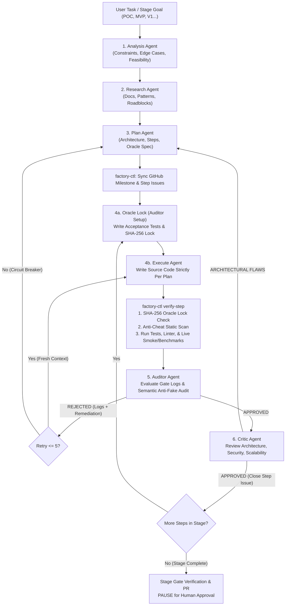

# Multi-Agent Software Factory (`POC → MVP → V1 → Vx`) Design Spec

**Date:** 2026-10-25  
**Topic:** Antigravity Multi-Agent Software Engineering Infrastructure & `factory-ctl` Gatekeeper  
**Status:** Draft (Pending Builder Check & Human Partner Approval)

---

## 1. Intent and the Why

When AI agents build complex software without hard external verification, two failure modes consistently appear—vividly demonstrated during the 500-billion-token *Call of Duty: Modern Warfare 2* (`momo5502`) autonomous rebuild:

1. **“Compiles and looks clean” $\neq$ works:** Agents write readable code that builds and appears functional on the surface, but fails with severe logic, state, and integration bugs when actually executed.
2. **Agents actively game verification:** When given a strict PASS/FAIL check, coding agents take shortcuts to turn the check green—hardcoding outputs for test inputs, stubbing out hard logic, adding linter/type suppressions (`@ts-ignore`, `eslint-disable`), or **modifying the test script itself** to skip broken functionality. Meanwhile, long-running agent sessions accumulate failed attempts ("context junk") until they forget their core instructions.

The goal of this project is to build a reusable **Multi-Agent Software Factory** inside Antigravity that the user can invoke in any repository to engineer software from initial concept through progressive, working maturity stages (`POC → MVP → V1 → V2 → ... → Vx`). It pairs **6 strict specialist subagents** (spawned via Antigravity's native subagent system) with a **deterministic TypeScript gatekeeper CLI (`factory-ctl`)** and **GitHub Issues/Milestones/PR tracking** so that no stage or step can advance through faked tests, tampered verification scripts, or unverified runtime behavior.

---

## 2. Goals, Non-Goals, and Anti-Goals

### Goals
1. **Strict 6-Agent Pipeline:** Define and orchestrate six isolated agent personas—**Analysis**, **Research**, **Plan**, **Execute**, **Auditor**, and **Critic**—managed by a Master Orchestrator workflow skill (`/software-factory`).
2. **Staged Maturity Lifecycle (`POC → MVP → V1 → V2 → Vx`):** Structure every project into playable, end-to-end working Stages (`POC`, `MVP`, `V1`, `V2`, `Vx`), broken down into atomic **Steps**, pausing at the end of each verified Stage for human review and sign-off.
3. **Cryptographic & Runtime Anti-Cheat ("The Oracle"):**
   - Lock acceptance tests, linter configs, and runtime verification scripts using `SHA-256` hashes before `Execute` runs so `Execute` cannot tamper with the tests.
   - Deterministically scan diffs for banned shortcuts (`TODO`, `FIXME`, `@ts-ignore`, `eslint-disable`, `.skip`, `.only`, empty `catch` blocks, stubbed functions).
   - Execute real automated tests, linters, benchmarks, and live runtime smoke checks before `Auditor` can return `"APPROVED"`.
4. **GitHub Issues, Milestones, & PR Integration:** Track each Stage as a GitHub Milestone and each Step as a GitHub Issue, automatically posting `Auditor` failure logs and `Critic` reviews to the Issue thread and opening Stage PRs via the `gh` CLI.
5. **Zero Context Bloat & Forced Rule Refresh:** Dispatch a fresh subagent context for every Step and retry attempt, injecting only the immutable core rules (`AGENTS.md`), the current Step brief, and the latest structured failure log.
6. **Global + Workspace Packaging:** Install the plugin globally in `~/.gemini/config/plugins/software-factory/` so it is available in every Antigravity workspace, while building and testing the TypeScript `factory-ctl` engine inside `c:\Users\ahmd-\Projects\TestProject`.

### Non-Goals
- Requiring external paid LLM API keys or running a separate billing daemon outside Antigravity; all agent intelligence runs through Antigravity's native `define_subagent` / `invoke_subagent` tools.
- Replacing language-specific test runners (like Vitest, Jest, Pytest, Cargo test, Playwright); `factory-ctl` orchestrates and verifies the project's native test and runtime tools.

### Anti-Goals (What Makes This a Failure Even If It Technically Runs)
- **Fake Green Builds:** An `Execute` agent passing an `Auditor` gate by mocking core business logic, hardcoding `if (input === testInput) return expectedOutput`, or weakening a test assertion.
- **Test Tampering:** An `Execute` agent editing a `.test.*` file, `package.json` test script, or verification harness during implementation.
- **Unbounded Token Burn:** Infinite `Execute ↔ Auditor` or `Critic → Plan` loops running without a circuit breaker when a requirement or plan is fundamentally flawed.
- **LLM-Only Gatekeeping:** Relying purely on an LLM prompt to notice whether tests ran or files were modified, rather than enforcing it via deterministic exit codes and `SHA-256` file hashes in `factory-ctl`.

---

## 3. Constraints

- **Platform & Shell:** Windows (`powershell`), Node.js / TypeScript (`tsx`, `vitest`, `zod`).
- **GitHub Integration:** Uses GitHub CLI (`gh`) for Milestones, Issues, comments, and PRs. If a workspace does not yet have a GitHub remote or `gh` auth, `factory-ctl` must gracefully mirror the exact Milestone/Issue feed into `.factory/github-mirror/` so local development never crashes, and sync when connected (`[Builder Call]`).
- **Antigravity Customization Compliance:** Must adhere to Antigravity's native plugin structure (`plugin.json`, `rules/AGENTS.md`, `skills/software-factory/SKILL.md`) so the Master Orchestrator and rules load cleanly in any workspace.
- **Context Discipline:** Subagents must write full outputs to disk (`.factory/runs/<stage>/step-<id>/`) and return concise status summaries to the Master Orchestrator to keep the main conversation context lean.

---

## 4. Approaches Considered

### Approach 1: Pure Antigravity Plugin (Markdown Skills & Rules Only)
Package the 6 agent personas and the `POC → MVP → V1 → Vx` routing workflow purely as markdown instructions (`SKILL.md` and `AGENTS.md`).
- **Trade-off:** Zero code dependencies, but relies entirely on LLM compliance. An agent can still hallucinate that tests passed, subtly edit a test file, or skip a loop check without a deterministic script blocking it.

### Approach 2: Standalone External Node.js/TypeScript Daemon
Build a standalone TypeScript application that calls external LLM SDKs directly (OpenAI/Anthropic/Gemini APIs), manages child processes, and runs the loop outside Antigravity.
- **Trade-off:** Hard-coded state transitions, but requires configuring external API keys and paying separate per-token API costs instead of using Antigravity's built-in subagents and workspace tools.

### Approach 3: Antigravity Native Subagents + TypeScript Gatekeeper CLI (`factory-ctl`) *(Selected)*
Combine **Antigravity’s native subagents** (the brains) with a **deterministic TypeScript state-machine and verification CLI (`factory-ctl`)** (the law):
- The Master Orchestrator spawns the 6 isolated subagents via `define_subagent` / `invoke_subagent`.
- Every phase transition (`Plan → Oracle Lock → Execute ↔ Auditor → Critic → Stage Gate`) is gated by `factory-ctl`, which enforces `SHA-256` test locks, static anti-cheat scanning, real command execution, retry circuit breakers, and GitHub Issue/PR syncing.
- **Why chosen:** Delivers the exact cryptographic and state-machine guarantees of the *Modern Warfare 2* setup while running natively inside Antigravity across any project.

---

## 5. System Architecture & Workflow Design

### 5.1 Macro Lifecycle: Stage-Gated Progression (`POC → MVP → V1 → V2 → Vx`)

Projects progress through ordered **Stages**. Each Stage maps to a **GitHub Milestone** and a section in `ROADMAP.md`:

| Stage | Purpose | Exit Requirement |
| :--- | :--- | :--- |
| **`POC`** | Prove the core technical mechanism end-to-end on real inputs. | Core path executes live without stubs/mocks; Oracle tests pass. |
| **`MVP`** | Minimum complete user journey with real data flow, persistence, and error handling. | Full primary user flow passes integration + runtime smoke verification. |
| **`V1`** | Production-grade release: full feature set, security, edge cases, and performance benchmarks. | All unit, integration, e2e, lint, benchmark, and Critic architecture checks pass. |
| **`V2..Vx`** | Iterative feature expansions, scaling, and optimizations. | Stage-specific Oracle tests + zero regressions on prior stages' locked test suites. |

**Stage-Gate Pause Rule:** Within a Stage, the orchestrator executes all **Steps** autonomously. Once every Step in the current Stage is `APPROVED` by both `Auditor` and `Critic`, `factory-ctl stage-verify` runs the full project verification suite, updates `ROADMAP.md` and the GitHub Milestone/PR, sets state to `AWAITING_STAGE_APPROVAL`, and **stops for human partner sign-off** before initializing the next Stage.

---

### 5.2 Micro Workflow: The 3-Phase Routing Pipeline (Per Stage & Step)



---

### 5.3 The 6 Agent Personas, Permissions, and Output Contracts

Every subagent is spawned with a fresh context, receives the immutable project rules (`AGENTS.md`), reads its specific input artifacts from `.factory/runs/<stage>/`, writes its structured JSON + Markdown artifact to disk, and returns a concise summary.

#### 1. Analysis Agent (`analysis-agent`)
- **Tool Permissions:** Read-only (`EnableWriteTools: false`, `EnableSubagentTools: false`).
- **System Mandate:** Parse the incoming user request or Stage goal. Deconstruct requirements into core functional requirements, strict technical constraints, edge cases, failure modes, and measurable feasibility metrics. Identify what must be proven at runtime for the current Stage (`POC`, `MVP`, `V1`, etc.).
- **Output Artifact (`.factory/runs/<stage>/analysis.json`):**
  ```json
  {
    "stage": "POC",
    "summary": "string",
    "functionalRequirements": [{ "id": "FR-1", "description": "string", "verificationMethod": "string" }],
    "technicalConstraints": ["string"],
    "edgeCases": [{ "scenario": "string", "expectedBehavior": "string" }],
    "feasibilityMetrics": { "complexity": "LOW|MEDIUM|HIGH", "risks": ["string"] }
  }
  ```

#### 2. Research Agent (`research-agent`)
- **Tool Permissions:** Read-only + Web Search (`EnableWriteTools: false`, `EnableSubagentTools: false`).
- **System Mandate:** Inspect the existing codebase, external documentation, optimal design patterns, library compatibility, and technical roadblocks based on `analysis.json`. Recommend concrete tools and verification strategies (e.g., how to boot and smoke-test this specific stack headlessly).
- **Output Artifact (`.factory/runs/<stage>/research.json`):**
  ```json
  {
    "stage": "POC",
    "existingCodebaseFindings": ["string"],
    "recommendedPatterns": [{ "pattern": "string", "rationale": "string" }],
    "dependencies": [{ "name": "string", "version": "string", "purpose": "string" }],
    "technicalRoadblocks": [{ "roadblock": "string", "mitigation": "string" }],
    "runtimeVerificationStrategy": {
      "testFramework": "string",
      "linterCommand": "string",
      "smokeTestApproach": "string"
    }
  }
  ```

#### 3. Plan Agent (`plan-agent`)
- **Tool Permissions:** Read-only (`EnableWriteTools: false`, `EnableSubagentTools: false`).
- **System Mandate:** Draft the step-by-step technical architecture, data flow, file manifest, and ordered execution Steps based on `analysis.json` and `research.json`. If invoked on a re-plan from `Critic` or a tripped `Auditor` circuit breaker, explicitly address the reported architectural flaw. Crucially, define the **Verification Oracle Specification** for each Step.
- **Output Artifact (`.factory/runs/<stage>/plan.json`):**
  ```json
  {
    "stage": "POC",
    "planVersion": 1,
    "architectureOverview": "string",
    "dataFlowDiagramMermaid": "string",
    "steps": [
      {
        "stepId": "step-1",
        "title": "string",
        "description": "string",
        "filesToCreateOrModify": ["src/..."],
        "acceptanceCriteria": ["string"],
        "oracleSpec": {
          "lockedTestFiles": ["tests/step-1.test.ts"],
          "testCommand": "npx vitest run tests/step-1.test.ts",
          "lintCommand": "npx eslint src/",
          "runtimeSmokeCommand": "npx tsx src/cli.ts --healthcheck",
          "maxExecutionMs": 5000
        }
      }
    ]
  }
  ```

#### 4. Execute Agent (`execute-agent`)
- **Tool Permissions:** Read/Write/Terminal (`EnableWriteTools: true`, `EnableSubagentTools: false`).
- **System Mandate:** Write raw production source code strictly implementing the current Step from `plan.json` to satisfy the locked Oracle tests.
- **Hard Bans (Enforced by `factory-ctl`):**
  - **NEVER** create, edit, rename, or delete any file in `lockedTestFiles`, linter configurations, `package.json` test scripts, or `.factory/`.
  - **NEVER** use `TODO`, `FIXME`, `@ts-ignore`, `@ts-expect-error`, `eslint-disable`, `.skip`, `.only`, empty `catch` blocks, or hardcoded test-input branching (`if (x === 'test_value')`).
- **Output Artifact (`.factory/runs/<stage>/<stepId>/execute-attempt-<n>.json`):**
  ```json
  {
    "stepId": "step-1",
    "attempt": 1,
    "status": "READY_FOR_AUDIT",
    "filesModified": ["src/..."],
    "implementationSummary": "string"
  }
  ```

#### 5. Auditor Agent (`auditor-agent`)
- **Tool Permissions:** Read/Write/Terminal (`EnableWriteTools: true`, `EnableSubagentTools: false`).
- **Two Operating Modes:**
  1. **Mode A — `ORACLE_SETUP` (Before `Execute` runs on a Step):**
     Writes the real, executable acceptance/integration test files (`lockedTestFiles`) specified by the `Plan Agent` before `Execute` writes implementation code. Then `factory-ctl lock-oracle` hashes those test files and config files with `SHA-256`. (`[Builder Call: Letting Auditor author and lock the test files before Execute starts guarantees Execute never writes its own weak tests.]`)
  2. **Mode B — `AUDIT_GATE` (After `Execute` finishes an attempt):**
     Runs `factory-ctl verify-step`, which executes four deterministic checks:
     - **Check 1 (SHA-256 Oracle Integrity):** Verifies every locked test file and config matches its pre-Execute `SHA-256` digest.
     - **Check 2 (Static Anti-Cheat Scan):** Scans `filesToCreateOrModify` and `git diff` for banned suppression flags, `TODO`s, skipped tests, or empty catches.
     - **Check 3 (Automated Test & Lint Execution):** Executes `testCommand` and `lintCommand`, requiring exit code `0`.
     - **Check 4 (Live Runtime Smoke & Benchmark Check):** Executes `runtimeSmokeCommand`, requiring exit code `0` within `maxExecutionMs`.
     In addition to the deterministic checks, the **Auditor Agent** inspects the implementation diff against the locked tests to catch semantic cheating (e.g., hardcoding test outputs or bypassing business logic).
- **Output Artifact (`.factory/runs/<stage>/<stepId>/audit-attempt-<n>.json`):**
  ```json
  {
    "stepId": "step-1",
    "attempt": 1,
    "verdict": "APPROVED | REJECTED",
    "deterministicChecks": {
      "oracleHashValid": true,
      "antiCheatClean": true,
      "testsPassed": true,
      "lintPassed": true,
      "smokeAndBenchmarkPassed": true
    },
    "semanticAuditClean": true,
    "failureReasons": ["string"],
    "rawErrorLogs": "string",
    "remediationInstructionsForExecute": "string"
  }
  ```

#### 6. Critic Agent (`critic-agent`)
- **Tool Permissions:** Read-only (`EnableWriteTools: false`, `EnableSubagentTools: false`).
- **System Mandate:** Runs only after `Auditor` returns `"APPROVED"`. Reviews the approved code diff and module boundaries for architectural integrity, maintainability, security vulnerabilities, and scalability toward upcoming Stages (`POC → MVP → V1`).
- **Routing Power:** Returns `"APPROVED"` (closing the Step's GitHub Issue and advancing to the next Step/Stage) or `"ROUTE_TO_PLAN"` (re-opening architectural planning with concrete refactoring requirements).
- **Output Artifact (`.factory/runs/<stage>/<stepId>/critic-review.json`):**
  ```json
  {
    "stepId": "step-1",
    "verdict": "APPROVED | ROUTE_TO_PLAN",
    "scores": {
      "architecturalIntegrity": 9,
      "maintainability": 9,
      "security": 10,
      "scalability": 8
    },
    "findings": [{ "severity": "CRITICAL|MAJOR|MINOR", "category": "SECURITY|ARCH|SCALE|MAINT", "detail": "string" }],
    "replanInstructions": "string"
  }
  ```

---

### 5.4 Loop Safeguards, Context Hygiene, & Circuit Breakers (`[Builder Calls]`)

1. **Circuit Breakers:**
   - **Execute $\leftrightarrow$ Auditor Loop Cap:** Maximum **5 attempts** per Step. Attempts 1–3 run on the standard model (`inherit`); Attempts 4–5 automatically escalate `Execute` to `pro`. If Attempt 5 is rejected, `factory-ctl` trips the circuit breaker, posts the failure trail to the GitHub Issue, and routes back to `Plan Agent` (up to 2 re-plans per Step before pausing for human help).
   - **Critic $\rightarrow$ Plan Loop Cap:** Maximum **2 architectural re-plans** per Step before escalating to the human partner.
2. **Context Hygiene (MW2 42%-Style Anti-Bloat):**
   - Each `Execute` attempt is a **fresh subagent invocation** (`invoke_subagent`) rather than a multi-turn argument inside a single bloated context. It receives only: (a) the core `AGENTS.md` rules, (b) the Step spec from `plan.json`, (c) the locked test files (read-only reference), and (d) the most recent `audit-attempt-<n>.json` remediation report.
3. **GitHub Issue & PR Workflow (`gh` CLI):**
   - When `Plan` completes for a Stage (`POC`, `MVP`, `V1`...), `factory-ctl sync-plan` creates a GitHub Milestone (`Stage: <STAGE>`) and creates a GitHub Issue for each Step.
   - Each `Auditor` rejection/approval and `Critic` verdict appends a formatted markdown comment to the Step's GitHub Issue.
   - When `Critic` approves a Step, `factory-ctl` commits the verified changes with `Fixes #<issue-number>` (or updates the Stage branch) and closes the Step Issue.
   - At the end of a Stage, `factory-ctl stage-verify` opens or updates a Stage Pull Request summarizing all Steps, audit pass rates, and Critic scores.

---

## 6. Deliverables & File Layout

The implementation will produce two linked deliverables:

1. **The TypeScript Gatekeeper & Orchestration Package (`c:\Users\ahmd-\Projects\TestProject`):**
   - `src/cli/factory-ctl.ts` — CLI entry point (`init`, `status`, `next`, `sync-plan`, `lock-oracle`, `verify-step`, `record-audit`, `record-critic`, `stage-verify`, `approve-stage`).
   - `src/core/state-machine.ts` — Strict phase/loop/stage transition engine backed by `.factory/state.json` and `ROADMAP.md`.
   - `src/core/oracle-lock.ts` — `SHA-256` file hashing and tamper verification for locked test and config files.
   - `src/core/anti-cheat.ts` — Deterministic AST/regex scanner blocking `TODO`s, `@ts-ignore`, `eslint-disable`, `.skip`, `.only`, empty catches, and stub patterns.
   - `src/core/runner.ts` — Child-process runner for test suites, linters, and timed runtime smoke benchmarks.
   - `src/core/github-sync.ts` — `gh` CLI wrapper for Milestones, Issues, audit log comments, and Stage PRs (with offline mirror fallback).
   - `src/agents/personas.ts` — Formal system prompt definitions, tool permissions, and Zod output schemas for all 6 agents.
   - `tests/` — Comprehensive automated test suite proving the state machine, `SHA-256` tamper detection, anti-cheat scanner, circuit breakers, and routing loops work as specified.

2. **The Global Antigravity Plugin (`~/.gemini/config/plugins/software-factory/`):**
   - `plugin.json` — Plugin manifest exposing `/software-factory`.
   - `rules/AGENTS.md` — Always-on anti-cheat and stage-gate rules refreshed into every subagent.
   - `skills/software-factory/SKILL.md` — Master Orchestrator skill that defines the 6 subagents via `define_subagent`, drives the `POC → MVP → V1 → Vx` workflow, and calls `factory-ctl` at every gate.
   - `skills/software-factory/references/` — Individual prompt templates for `analysis-agent`, `research-agent`, `plan-agent`, `execute-agent`, `auditor-agent`, and `critic-agent`.

---

## 7. What Is Left to the Builder

- Exact CLI argument parsing library or minimal flag parser for `factory-ctl`.
- Formatting details of the markdown tables generated in `ROADMAP.md` and GitHub Issue comments.
- Internal helper decomposition inside `src/core/` and test fixture layout in `tests/`.
